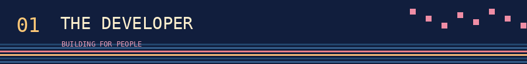
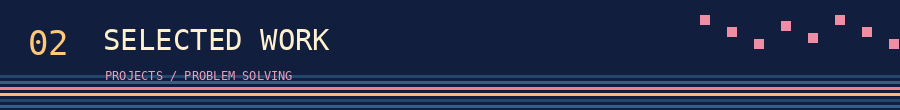
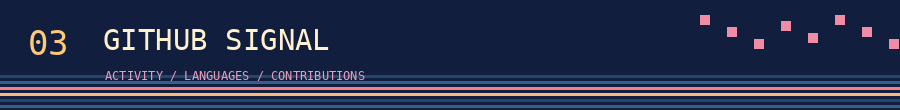
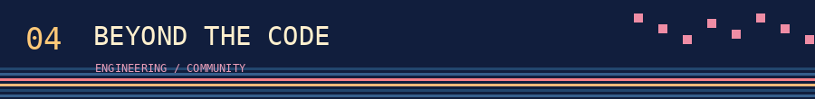
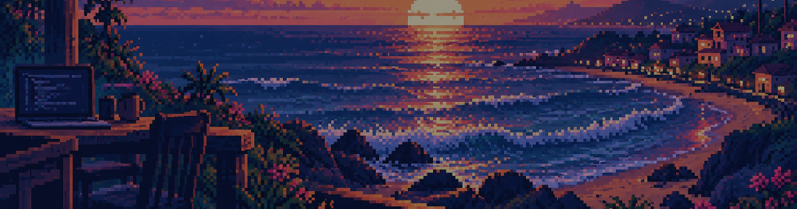

# Jared Esquivel

Senior Software Developer @ Digital NEST · Founder, HackWatsonville · HITEC Scholar

*Turning ideas into action.*

[Portfolio](https://jared-esquivel.github.io/Jared-Esquivel-s-Portfolio-) &nbsp;·&nbsp; [LinkedIn](https://www.linkedin.com/in/jared-esquivel-0a699632a) &nbsp;·&nbsp; [Repositories](https://github.com/jared-esquivel?tab=repositories)

I build web experiences with **React, TypeScript, and JavaScript**, with a focus on accessibility, performance, and making interfaces easier to use. At Digital NEST, I work on real client-facing software. Outside of work, I founded **HackWatsonville** to bring builders together in my community.

| Frontend engineering | Programming & exploration |
|:--|:--|
| React · TypeScript · JavaScript · HTML · CSS | C++ · Python · Git · GitHub |
| Accessibility · responsive UI · SEO · performance | Data structures · AI/ML · cybersecurity |

<table>
<tr><td width="50%" valign="top">

### [Honors Transfer Club](https://github.com/jared-esquivel/Honors_Club_Webpage)

A website supporting the Cabrillo Honors Transfer Club and its student community.

[View source →](https://github.com/jared-esquivel/Honors_Club_Webpage)

</td><td width="50%" valign="top">

### [Clearpoint](https://github.com/jared-esquivel/clearpoint-site)

A web-development service site, part of my frontend design and implementation work.

[View source →](https://github.com/jared-esquivel/clearpoint-site)

</td></tr>
<tr><td width="50%" valign="top">

### [Personal portfolio](https://github.com/jared-esquivel/Jared-Esquivel-s-Portfolio-)

My personal website and a home for selected work.

[View site →](https://jared-esquivel.github.io/Jared-Esquivel-s-Portfolio-)

</td><td width="50%" valign="top">

### [Explore more](https://github.com/jared-esquivel?tab=repositories)

Additional public repositories, experiments, and coursework.

[Browse repositories →](https://github.com/jared-esquivel?tab=repositories)

</td></tr>
</table>

How I approach engineering

I prioritize clear user flows, maintainable implementation, accessibility checks, and measurable improvements to performance and usability.

3D contributions (available after running the included workflow)

Contribution snake (from your existing workflow)

| Engineering | Community |
|:--|:--|
| **95+ Lighthouse scores** on website optimization work at Digital NEST | **Founder of HackWatsonville**, bringing people together to build |
| **PII learning tool** associated with an 80% improvement in understanding | **HITEC Foundation Scholar**, growing through mentorship and community |
| **AI-assisted prototyping**, with reported 35–45% faster workflows | Computer Science student at Cabrillo College |

Professional outcome figures are self-reported, not derived from GitHub activity.

*See you at the next build.*

[Explore my work](https://github.com/jared-esquivel?tab=repositories) · [Connect on LinkedIn](https://www.linkedin.com/in/jared-esquivel-0a699632a)

