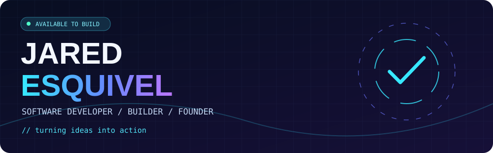
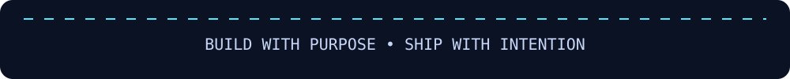

[Portfolio](https://jared-esquivel.github.io/Jared-Esquivel-s-Portfolio-) · [LinkedIn](https://www.linkedin.com/in/jared-esquivel-0a699632a) · [Projects](https://github.com/jared-esquivel?tab=repositories)

### `01 // engineering.snapshot`

I build thoughtful digital experiences with a focus on **frontend engineering, accessibility, performance, and real-world impact**. At Digital NEST, I work on software development initiatives; beyond work, I founded HackWatsonville to help bring people together around technology.

<table><tr><td align="center"><strong>95+</strong> Lighthouse scores Accessibility / SEO work</td><td align="center"><strong>80%</strong> Learning improvement PII training initiative</td><td align="center"><strong>35–45%</strong> Faster prototyping AI-assisted workflows</td></tr></table>

Selected project outcomes; not GitHub contribution statistics. Results reflect professional work and may not have public source code.

### `02 // selected.builds`

A design-first marketing site for a web development service. The public repository includes HTML, CSS, JavaScript, and assets. [Explore source →](https://github.com/jared-esquivel/clearpoint-site)

A responsive, multi-page website connecting students with resources, events, and involvement opportunities. [Explore source →](https://github.com/jared-esquivel/Honors_Club_Webpage)

Professional engineering highlights include web accessibility and SEO improvements, a PII learning tool, and AI-assisted prototyping. These are **experience highlights**, not claims that the underlying work is publicly available in this account.

### `03 // stack.matrix`

Explore how I approach engineering

- **Interface engineering:** responsive UI, clarity, accessible interactions.
- **Performance and quality:** Lighthouse audits, practical SEO, iterative improvements.
- **Software fundamentals:** C++ data structures and problem solving.
- **AI-assisted development:** prototyping, evaluation, and keeping human review in the loop.

### `04 // developer.telemetry`

3D contribution skyline (generated daily)

### `05 // contribution.arcade`

<picture><source media="(prefers-color-scheme: dark)" srcset="https://raw.githubusercontent.com/jared-esquivel/jared-esquivel/output/github-snake-dark.svg" /></picture>

### `06 // beyond.the.code`

- **Digital NEST:** Senior Software Developer, building digital tools and improving user experiences.
- **HackWatsonville:** Founder, bringing a community hackathon from idea to launch.
- **HITEC Foundation:** Scholar focused on growing as a technology leader.

Currently exploring

AI and machine learning, cybersecurity, frontend architecture, and the intersection of technology and community impact.

[Let's connect on LinkedIn](https://www.linkedin.com/in/jared-esquivel-0a699632a)

